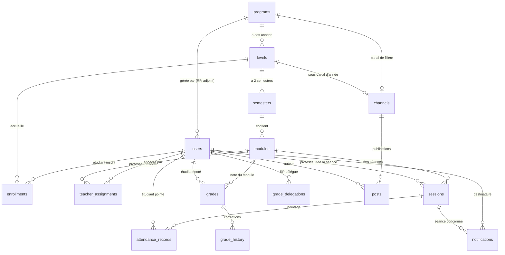

# Schéma de la base de données

Version A-4 · à valider par T et C. Les migrations qui font foi sont dans
`src/db/migrations/` : ce document les explique.

## Diagramme

GitHub affiche ce diagramme directement.

## Tables

| Table                 | Entité du cahier des charges | Règles              | Contraintes principales                                                                                                                          |
| --------------------- | ---------------------------- | ------------------- | ------------------------------------------------------------------------------------------------------------------------------------------------ |
| `programs`            | Filière                      | RG-09               | Nom unique, durée de 1 à 8 ans                                                                                                                   |
| `levels`              | Année (niveau) + cohorte     | RG-09               | Unique (filière, numéro, cohorte)                                                                                                                |
| `semesters`           | Semestre                     | RG-09, RG-26        | Numéro 1 ou 2 ; **un seul semestre actif** par année                                                                                             |
| `modules`             | Module                       | RG-26               | Volume horaire > 0 ; nom unique dans le semestre                                                                                                 |
| `users`               | Utilisateur                  | RG-02 à RG-07       | E-mail unique (majuscules ignorées) ; RP et adjoint toujours liés à une filière ; super étudiant forcément étudiant                              |
| `enrollments`         | Inscription étudiant         | RG-11, RG-36, RG-38 | **Une seule inscription en cours** par étudiant ; les anciennes sont gardées                                                                     |
| `teacher_assignments` | Affectation professeur       | RG-03, RG-04        | Unique (professeur, module) ; filière et année retrouvées par le module                                                                          |
| `sessions`            | Séance                       | RG-12, RG-13, RG-28 | Fin après début, 12 h maximum ; statut cohérent avec ses dates (confirmée ⇔ date et auteur de confirmation) ; pas d'annulation après le pointage |
| `attendance_records`  | Présence                     | RG-15 à RG-18       | Valeur P ou A ; **une seule ligne** par étudiant et par séance                                                                                   |
| `grades`              | Note                         | RG-20, RG-21, RG-24 | Valeur A, B ou F ; **UNIQUE (étudiant, module)** ; publiée ⇔ date et auteur de publication                                                       |
| `grade_history`       | Historique de note           | RG-23               | Motif obligatoire ; l'ancienne et la nouvelle note diffèrent                                                                                     |
| `grade_delegations`   | Délégation de correction     | RG-22               | Temporaire ⇒ date de fin ; durable ⇒ sans date de fin ; retrait anticipé dans `revoked_at`                                                       |
| `channels`            | Canal                        | RG-30               | Un seul canal général, un par filière, un par année ; portée cohérente avec sa cible                                                             |
| `posts`               | Publication                  | RG-31 à RG-35       | Titre de 1 à 200 caractères, contenu de 1 à 5 000 ; `edited_at` = mention « modifié » ; masquage avec son auteur                                 |
| `notifications`       | Notification                 | RG-14, RG-36        | Une notification de séance pointe toujours vers sa séance                                                                                        |

## Ce que la base ne vérifie pas (vérifié par les services)

Ces règles dépendent de l'heure du serveur ou de plusieurs tables à la fois. Elles seront
testées avec les services :

| Règle                                                                           | Où                                     | Tâche     |
| ------------------------------------------------------------------------------- | -------------------------------------- | --------- |
| Pointage uniquement pendant la plage de la séance (RG-15)                       | `attendance.service`                   | A-9       |
| Correction du pointage dans les 15 minutes (RG-16, RG-17)                       | `attendance.service`                   | A-9       |
| Le professeur d'une séance est affecté au module, sans chevauchement de séances | `schedule.service`                     | A-7       |
| L'étudiant pointé ou noté est inscrit dans l'année du module                    | `attendance.service`, `grades.service` | A-9, A-10 |
| Le professeur ne modifie pas une note déjà saisie (RG-21)                       | `grades.service`                       | A-10      |
| Correction réservée au directeur ou au RP avec une délégation active (RG-22)    | `grades.service`                       | A-10      |
| Modification d'une publication par son auteur dans les 5 minutes (RG-34)        | `channels.service`                     | A-12      |
| Numéro d'année inférieur ou égal à la durée de la filière                       | `structure.service`                    | A-6       |
| Création automatique des canaux d'une nouvelle filière ou d'une nouvelle année  | `structure.service`                    | A-6       |

## Calculs (faits dans PostgreSQL)

- **Heures restantes d'un module (RG-28)** : `total_hours` − somme des durées
  (`ends_at − starts_at`) des séances `confirmed` du module.
- **Assiduité (RG-19)** : sur les séances `confirmed` seulement (décision validée n° 3),
  nombre de lignes `A` et pourcentage de `P` par module et au total.

## Prévu par d'autres tâches

- Code de double vérification par e-mail (RG-07) : table ajoutée par C dans la tâche C-6.
